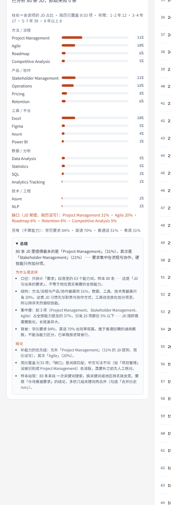

<div align="center">

# jobmatch

**A local-first job-hunting workbench for Hong Kong.**
Paste your CV → scrape a job board → score every posting against you → understand the market.


[Quick start](#quick-start) · [How it works](#how-it-works) · [Add a job board](#add-a-new-job-board) · [中文说明](README.zh-CN.md)

</div>

---

Most job hunts are: open a board, read 80 postings, forget which ones you already read, and have no idea whether HKD 35k is good for someone with 3 years of experience.

`jobmatch` is a single Node process that turns that into a local web app:

- parses your CV into a **profile** (skills / titles / domains / years) — offline, no LLM, nothing leaves the machine;
- searches a job board, **scores every posting 0–100** against that profile, gates it on experience, and sorts into **A / B / C / X** tiers;
- fetches the **full JD** for each posting, extracts the experience requirement, and estimates pay when the employer hid it;
- turns the whole pool into **market answers**: which capabilities the JDs actually ask for, what they pay at each experience level, and where your CV has gaps.

No `npm install`. No account. No cloud. The only thing that leaves your machine is the job search query.

<table>
<tr>
<td width="33%"></td>
<td width="33%"></td>
<td width="33%"></td>
</tr>
<tr>
<td><sub>Ranked postings, scored against your CV. <b>新</b> = posted in the last 3 days, <b>已看</b> = you already opened it.</sub></td>
<td><sub>Median pay per experience bucket, computed from <i>disclosed</i> salaries only, with an inferred fallback column.</sub></td>
<td><sub>What the JDs ask for, grouped by capability, plus a rule-based summary and your gaps.</sub></td>
</tr>
</table>

## Why this exists

Job boards optimise for applications, not decisions. They will happily hand you a long list of postings, none of which tell you:

1. **Is this actually reachable?** — a 10-year role is not a 2-year role, but both sit in the same list.
2. **What does the market pay at my level?** — quoted medians usually mix interns with VPs.
3. **What am I missing?** — "requirements: SQL, Tableau, stakeholder management" is a checklist nobody tallies across 80 postings.

`jobmatch` answers those three, locally, and keeps the evidence (which JD, which sentence, which salary band) next to every number.

## Features

**Matching**
- CV parsing for PDF / DOCX / TXT, offline (pdf.js-free, hand-rolled extractors + a skill lexicon)
- 7-factor weighted score: skills 30%, experience 20%, title 15%, domain 12%, freshness 10%, location 8%, work type 5%
- **Experience gate** — if the JD asks for more years than you have, the whole score is multiplied by a penalty (0.5 by default) instead of being silently ignored
- A / B / C / X tiers, per-factor breakdown, live "re-weight and re-rank" without re-scraping
- `新` (posted ≤ 3 days) and `已看` (you opened it) badges, persisted in the browser

**Data**
- Full JD text via the board's own API (GraphQL), with graceful fallback to the search teaser when blocked
- Experience requirement parsed from the JD with an explicit "not stated" state — never guessed
- Salary: disclosed ranges first; otherwise a platform salary-filter probe; an experimental exact bisect for logged-in users
- Everything cached on disk (`data/`), so re-opening a posting costs nothing

**Market insight**
- Capability ranking from JD requirement sections, grouped into data / tools / tech / method / product
- Gap analysis against your CV, plus a generated summary explaining *why* the numbers look like that
- Salary reference bucketed by years of experience, **disclosed salaries only**, with an `≈` inferred column when the disclosed sample is empty
- Chinese translations of titles/JDs, cached
- Markdown report export

## Quick start

Requirements: **Node.js ≥ 22** and a local Edge/Chrome (only needed for the experimental login-based features).

```bash
git clone https://github.com/<you>/jobmatch.git
cd jobmatch
```

Windows:

```bat
start.cmd
```

macOS / Linux:

```bash
./start.sh
```

Or run it directly:

```bash
node web/server.mjs          # http://127.0.0.1:7790
```

Or through the npm scripts (no dependencies, `npm install` is not needed):

```bash
npm start                    # same as node web/server.mjs
npm test                     # both offline test suites
```

Then, in the browser:

1. **Drop your CV** into the left panel (`.pdf` / `.docx` / `.txt` / `.md`) — it is parsed in-process and saved to `data/profile.json`.
2. Type a keyword (e.g. `product manager`), pick locations, pages and a posting-age window.
3. **开始匹配** — the list appears, ranked.
4. Click any row for the full JD, salary evidence and gap notes. The **JD 要求排行** button turns the whole pool into capability stats.

Environment overrides:

| Variable | Default | Meaning |
|---|---|---|
| `JOBMATCH_PORT` | `7790` | HTTP port (auto-increments if busy) |
| `JOBMATCH_DATA_DIR` | `./data` | All runtime data: profile, runs, caches |
| `JOBMATCH_BROWSER` | auto-detect | Path to Edge/Chrome for login-based features |

## How it works

```
 resume.pdf ──parse──▶ profile {skills, titles, years}
                              │
 keyword ──search──▶ postings ──score──▶ A/B/C/X ──┬─▶ web UI (list + detail)
                              │                  └─▶ report.md
                              └─fetch JD──▶ experience ──▶ insight / salary
```

- **Search** hits the board's JSON API, paginates, dedupes by `source:nativeId`, and records per-source counts plus the reason when blocked.
- **Scoring** is deterministic: token/lexicon matching against the profile, then a weighted sum. No LLM in the scoring path, so the same input always produces the same ranking.
- **JD fetching** dispatches per source adapter (`fetchDetail`), records which strategy produced the text (`graphql` / `html` / `search-api` / `teaser`), and never pretends a teaser is a full JD.
- **Salary** is layered: JD field → platform salary-filter probe (binary search over published bands) → optional exact bisect using the logged-in "salary match" badge.
- **Insight** aggregates only the *requirements* section of each JD, so company blurbs and benefits don't inflate the numbers.

Tests (offline, no network):

```bash
node bundle/bin/selftest.mjs           # 36 checks: parsers, scoring, insight, salary maths
node bundle/bin/architecture-test.mjs  # 10 checks: data invariants (runs, pages, dedupe)
```

## Add a new job board

Sources are adapters behind one contract — the app, scoring, UI and reports never know which board a job came from.

```
bundle/lib/sources/
  index.js        # registry + searchAll + fetchDetail dispatch
  jobsdb.js       # enabled: JSON search API + GraphQL JD
  govhk.js        # legacy adapter, kept as a reference implementation
  browser.js      # zero-dependency CDP driver for browser-only boards
  sites.js        # browser-based site configs (CTgoodjobs kept but disabled)
```

An adapter exports:

```js
export const descriptor = {
  id: 'example',
  label: 'Example Jobs',
  home: 'https://example.com',
  needsBrowser: false,        // true → driven through CDP instead of HTTP
}

export async function search({ keywords, pages }) {
  return { jobs: [...], totalCount: 123, warnings: [] }   // jobs[] use the shared Job shape
}

export async function fetchDetail(job) {
  return { ok: true, detail: { contentText, contentHtml, salary } }
}
```

Then:

1. add it to `CATALOG` in `bundle/lib/sources/index.js`;
2. add its `id` to `ENABLED_SOURCE_IDS`;
3. add a fixture + one `selftest` check so it stays verifiable offline.

See [`docs/sources.md`](docs/sources.md) for the full contract, the browser-source lifecycle (persistent profile, manual challenge pass) and the rate-limit/backoff rules.

## Project layout

```
bundle/
  bin/            CLI entrypoints + offline tests + salary calibration
  data/           lexicon (skills/titles/languages) + offline fixtures
  lib/
    domain/       pure logic: scoring, experience parsing, salary parsing, locations
    sources/      job board adapters (the extension point)
    features/     one folder per capability: search, details, salary, insight, report…
    storage/      run / page stores (atomic writes, guarded projections)
    service.js    the only surface the web layer calls
web/
  server.mjs      static files + JSON routes
  routes/         thin handlers → bundle service
  public/         vanilla HTML/CSS/JS, no build step
docs/             architecture, source contract, salary methodology
start.cmd/.sh     launchers
```

## Privacy

- Your CV, the scraped postings, salary probes and browser profile live in `data/`, which is **git-ignored**.
- There is no analytics, no telemetry, no remote service. The app listens on `127.0.0.1` only.
- The only outbound requests are the job-board queries you explicitly trigger.

## Roadmap

- [ ] Re-enable CTgoodjobs (needs a manual challenge pass) and add more boards
- [ ] Better salary inference for postings without any disclosure
- [ ] Aggregate insight/salary across keyword sets and historical runs
- [ ] Export to CSV / Notion / Google Sheets
- [ ] i18n for the UI (currently Chinese, with an English/Chinese title toggle)

## Limitations

- **Hong Kong first.** All shipped adapters target HK boards; locations, salary periods and language assumptions follow that.
- **Scraping is fragile by nature.** Selectors and endpoints change; that is why every adapter keeps a fixture and a fallback path.
- **Salary data is thin where it matters.** Only ~10% of HK postings disclose pay, so per-experience medians often have n = 3–10. The UI shows `n` and marks thin buckets instead of hiding them.
- **The exact-salary bisect is experimental** and needs a logged-in session.

## Disclaimer

This is a personal job-search tool. It reads publicly visible job postings at a deliberately slow rate (≥1.2 s between requests) and does not bypass authentication. You are responsible for complying with each site's terms of service and robots policy in your jurisdiction, and for not redistributing scraped content. No warranty; use at your own risk.

## Credits

Built as a zero-dependency Node project. Interface shapes were informed by public open-source work — see [`vendor/README.md`](vendor/README.md) for the list and what was (and was not) borrowed.

## License

[MIT](LICENSE)
