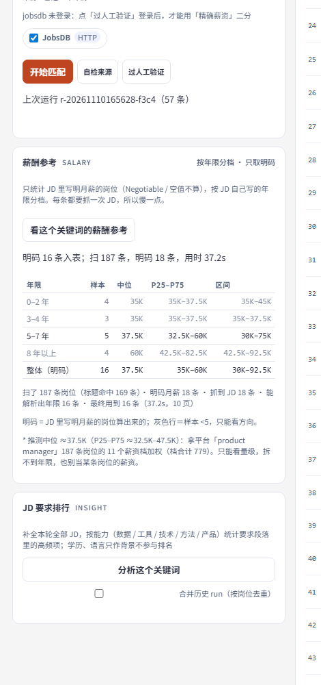
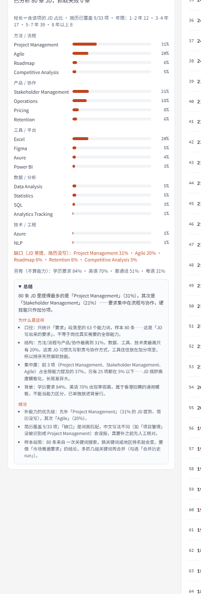

<div align="center">

# jobmatch · 求职匹配台

**一个跑在本机的香港求职工作台。**
放一份简历 → 抓一个招聘站 → 每条岗位按你的画像打分 → 看清这个市场到底要什么、给多少钱。


[快速开始](#快速开始) · [工作原理](#工作原理) · [加一个招聘站](#加一个招聘站) · [English](README.md)

</div>

---

找工作通常是：打开招聘站 → 翻 80 条 → 忘了哪几条看过 → 完全不知道 35K 对 3 年经验算高还是低。

`jobmatch` 把这些变成本地网页里的三件事：

- 把简历解析成**画像**（技能 / 职衔 / 行业 / 年限），纯离线规则，不上传、不调用模型；
- 搜索岗位后**逐条打分 0–100**，年限不达标会按系数扣分，再分成 **A / B / C / X** 档；
- 抓每条 JD 正文、解析年限要求、雇主没写薪资时用平台筛选反推；
- 把这个岗位池变成**市场答案**：JD 到底在要什么能力、各年限给多少钱、你的简历缺什么。

不需要 `npm install`，不需要账号，没有云端。离开你电脑的只有一个搜索关键词。

<table>
<tr>
<td width="33%"></td>
<td width="33%"></td>
<td width="33%"></td>
</tr>
<tr>
<td><sub>按你的画像排序。<b>新</b>＝3 天内发布，<b>已看</b>＝你点开过。</sub></td>
<td><sub>按年限分档的中位薪资，只取明码，样本为空时给推测值。</sub></td>
<td><sub>JD 要求按能力分组统计，附规则生成的总结与缺口。</sub></td>
</tr>
</table>

## 它解决什么

招聘站优化的是「投递量」，不是「决策」。它们能给你一大堆岗位，但没有一条能告诉你：

1. **这条够得着吗？** 10 年经验的岗位和 2 年的排在一张表里。
2. **我这个年限市场给多少？** 常见的中位数把实习和高管混在一起。
3. **我缺什么？** 80 条 JD 里的「SQL / Tableau / 跨部门」没人替你数。

`jobmatch` 就在本地回答这三件事，并且每个数字旁边都留证据（哪条 JD、哪句话、哪个薪资档）。

## 功能

**匹配**
- 简历解析：PDF / DOCX / TXT，纯离线（自写提取器 + 技能词表）
- 7 因子加权：技能 30%、经验 20%、职衔 15%、行业 12%、新鲜度 10%、地点 8%、工作类型 5%
- **年限门槛**：JD 要求年限高于你的年限时，整条分数 × 惩罚系数（默认 0.5），而不是假装没看见
- A / B / C / X 分档、因子拆解、改权重后不重新抓取即可重排
- `新`（3 天内发布）/ `已看`（你点开过）标识，存在浏览器本地

**数据**
- JD 正文走招聘站自己的接口（GraphQL），被拦时降级到搜索摘要并明确标注
- 年限要求解析有「未写明」状态，不猜
- 薪资：明码优先 → 平台薪资筛选反推 → 登录态下的精确二分（实验）
- 全部落盘缓存（`data/`），再点开一条不重复请求

**市场洞察**
- JD「要求段落」的能力统计，按 数据 / 工具 / 技术 / 方法 / 产品 分组
- 对照简历的缺口，并自动生成「为什么是这样 + 结论」
- 按年限分档的薪酬参考，只取明码，样本为空时给 `≈` 推测值
- 标题 / JD 中文翻译，带缓存
- Markdown 报告导出

## 快速开始

要求：**Node.js ≥ 22**，本机装有 Edge/Chrome（只有登录相关的实验功能用得到）。

```bash
git clone https://github.com/zsw1363574747/hk-jobmatch-ai.git
cd jobmatch
```

Windows：

```bat
start.cmd
```

macOS / Linux：

```bash
./start.sh
```

或者直接：

```bash
node web/server.mjs          # http://127.0.0.1:7790
```

用 npm 脚本（零依赖，不用 `npm install`）：

```bash
npm start                    # 等价于 node web/server.mjs
npm test                     # 两个离线测试一起跑
```

然后在浏览器里：

1. 左边拖入简历（`.pdf` / `.docx` / `.txt` / `.md`），本地解析后存到 `data/profile.json`；
2. 填关键词（例如 `product manager`）、选地点 / 页数 / 发布时间窗口；
3. 点**开始匹配**，列表就出来了；
4. 点任意一行看 JD 全文、薪资证据、差距说明；点**JD 要求排行**把整个池子变成能力统计。

环境变量：

| 变量 | 默认 | 含义 |
|---|---|---|
| `JOBMATCH_PORT` | `7790` | 端口（被占用时自动 +1） |
| `JOBMATCH_DATA_DIR` | `./data` | 所有运行时数据：画像、run、缓存 |
| `JOBMATCH_BROWSER` | 自动探测 | Edge/Chrome 路径 |

## 工作原理

```
 简历.pdf ──解析──▶ 画像 {技能, 职衔, 年限}
                        │
 关键词 ──搜索──▶ 岗位列表 ──打分──▶ A/B/C/X ──┬─▶ 网页（列表 + 详情）
                        │                    └─▶ report.md
                        └─抓 JD──▶ 年限 ──▶ 能力统计 / 薪酬
```

- **搜索**打招聘站的 JSON 接口、翻页、按 `source:nativeId` 去重，并记录每个来源的条数与被拦原因。
- **打分**是确定性的：词表/规则匹配后加权求和，不经过模型，同样输入永远同样排序。
- **抓 JD** 按来源分发到适配器，并记录这段正文来自哪种策略（`graphql` / `html` / `search-api` / `teaser`），绝不把摘要冒充正文。
- **薪资**是分层的：JD 字段 → 平台薪资筛选探针 → 登录态精确二分（实验）。
- **能力统计**只取每条 JD 的「要求段落」，公司介绍和福利不会把数字灌水。

离线测试（不联网）：

```bash
node bundle/bin/selftest.mjs           # 36 项：解析、打分、能力统计、薪资计算
node bundle/bin/architecture-test.mjs  # 10 项：数据不变量（run、页面、去重）
```

## 加一个招聘站

所有站点都是同一个契约后面的适配器——应用、打分、界面、报告都不知道岗位来自哪个站。

```
bundle/lib/sources/
  index.js        # 注册表 + searchAll + fetchDetail 分发
  jobsdb.js       # 已启用：JSON 搜索接口 + GraphQL 正文
  govhk.js        # 旧适配器，留作参考实现
  browser.js      # 零依赖 CDP 驱动，给只能开浏览器的站用
  sites.js        # 浏览器站配置（CTgoodjobs 代码保留、默认停用）
```

适配器导出：

```js
export const descriptor = {
  id: 'example',
  label: 'Example Jobs',
  home: 'https://example.com',
  needsBrowser: false,        // true → 走 CDP，不走 HTTP
}

export async function search({ keywords, pages }) {
  return { jobs: [...], totalCount: 123, warnings: [] }   // jobs[] 用统一的 Job 形状
}

export async function fetchDetail(job) {
  return { ok: true, detail: { contentText, contentHtml, salary } }
}
```

然后：

1. 加进 `bundle/lib/sources/index.js` 的 `CATALOG`；
2. 把 id 加进 `ENABLED_SOURCE_IDS`；
3. 补一份 fixture + 一条 `selftest`，让它在断网时也能被验证。

完整契约、浏览器站的生命周期（持久化 profile、人工过验证）、限速与退避规则见 [`docs/sources.md`](docs/sources.md)。

## 目录结构

```
bundle/
  bin/            CLI 入口 + 离线测试 + 薪资校准
  data/           词表（技能/职衔/语言）+ 离线 fixture
  lib/
    domain/       纯逻辑：打分、年限解析、薪资解析、地点
    sources/      招聘站适配器（扩展点）
    features/     一个能力一个目录：search、details、salary、insight、report…
    storage/      run / page 存储（原子写、带 runId 守卫的投影）
    service.js    web 层唯一调用的门面
web/
  server.mjs      静态文件 + JSON 路由
  routes/         薄处理器 → bundle service
  public/         原生 HTML/CSS/JS，无构建步骤
docs/             架构、来源契约、薪资方法
start.cmd/.sh     启动脚本
```

## 隐私

- 简历、抓到的岗位、薪资探针、浏览器 profile 全在 `data/`，已在 `.gitignore` 里**排除**。
- 没有统计、没有遥测、没有远程服务；服务只监听 `127.0.0.1`。
- 唯一的对外请求是你主动触发的招聘站查询。

## 路线图

- [ ] 恢复 CTgoodjobs（需要人工过一次验证）并接入更多站点
- [ ] 没写薪资的岗位做更好的推断
- [ ] 跨关键词、跨历史轮次聚合能力/薪资
- [ ] 导出 CSV / Notion / Google Sheets
- [ ] 界面 i18n（当前中文为主，标题支持中英切换）

## 限制（老实说）

- **先做香港**：现有适配器都针对香港站点，地点、薪资周期、语言假设都按香港来。
- **抓取天生脆弱**：页面结构会变，所以每个适配器都留了 fixture 和降级路径。
- **薪资数据很薄**：香港只有约 10% 的岗位写明薪资，所以分档后每档常常 n = 3–10。界面上会显示样本量、把样本不足的档标灰，而不是藏起来。
- **精确二分是实验功能**，需要登录态。

## 免责声明

这是一个个人求职工具。它按刻意放慢的速度（请求间隔 ≥1.2 秒）读取公开可见的招聘信息，不绕过任何登录验证。请自行确认所在地区相关站点的服务条款与 robots 政策，不要重新分发抓取到的内容。不提供任何担保。

## 致谢

零依赖的 Node 项目。接口形状参考了若干公开开源实现——清单与「借了什么 / 没借什么」见 [`vendor/README.md`](vendor/README.md)。

## 许可

[MIT](LICENSE)
